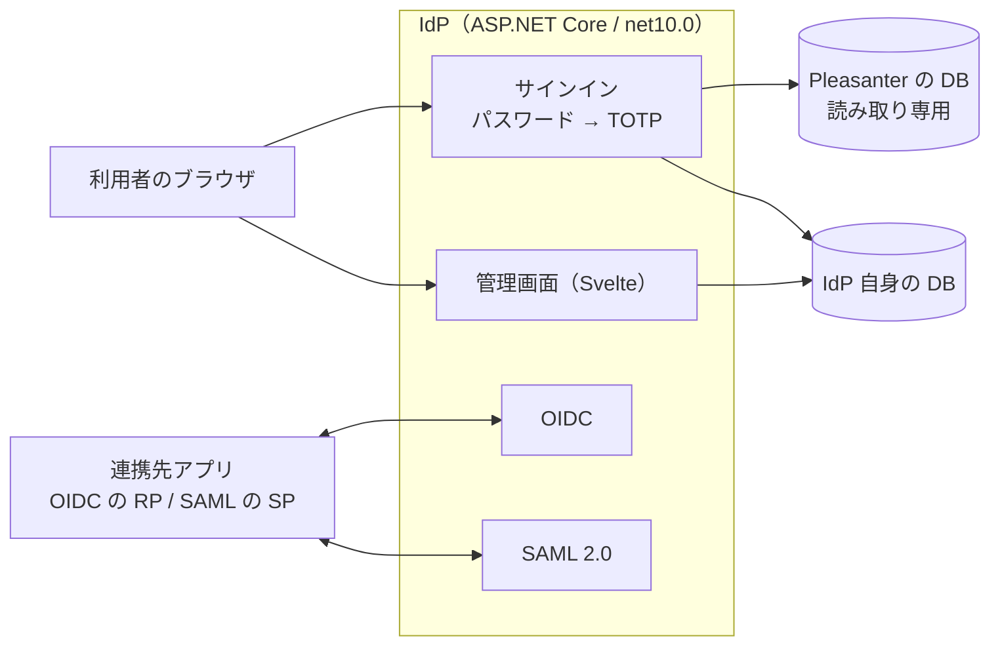

# VehicleVision.PleasanterTools.IdentityProvider

**Pleasanter の DB（ユーザー情報）を使って、SAML 2.0 / OpenID Connect の IdP を提供するサーバ。**

- 連携先のアプリは、**Pleasanter のユーザーでシングルサインオン**できる
- **Pleasanter 側で TOTP（二段階認証）が有効なユーザーは、Pleasanter が持つ共有鍵（`Users.SecretKey`）を
  そのまま使って**コードを検証する。認証アプリの再登録は要らない
- **Pleasanter の DB は読み取り専用で参照する。** 書き込まない。Pleasanter 本体は改造しない
- IdP 自身の状態（クライアント・署名鍵・セッションなど）は、**別の DB**（SQL Server / PostgreSQL / MySQL、
  簡易には SQLite）に持つ
- クライアント（OIDC）・サービスプロバイダ（SAML）・署名鍵・セッション・監査ログは、**管理画面**で扱う。
  管理者は Pleasanter のユーザー

主な機能は [`_documents/機能一覧.md`](_documents/機能一覧.md)、設計は
[`_documents/アーキテクチャ方針.md`](_documents/アーキテクチャ方針.md) を参照。

## 構成



## 技術スタック

Pleasanter 本体（`Pleasanter_1.5.9.0`）に揃えている。

| 層 | 採用 |
| --- | --- |
| ランタイム | .NET 10（`net10.0`）／SDK `10.0.100` |
| サーバ | C# / ASP.NET Core（最小 API）・Dapper・FluentMigrator |
| OIDC | 自前（Authorization Code + PKCE）。署名と検証は Microsoft.IdentityModel |
| SAML | ITfoxtec.Identity.Saml2 |
| TOTP | Otp.NET（Pleasanter 本体と同じ） |
| 管理画面 | TypeScript + Vite + Svelte + SCSS |
| 対応 RDBMS | SQL Server / PostgreSQL / MySQL（Pleasanter の DB と IdP 自身の DB の両方）。IdP 自身の DB は SQLite も可（簡易・検証用） |

## 導入する

初回導入・DB の作成・読み取り専用ユーザー・リバースプロキシ・更新・ロールバックは
[`_documents/導入-更新運用手順書.md`](_documents/導入-更新運用手順書.md)。設定の一覧は
[`_documents/設定パラメータ一覧.md`](_documents/設定パラメータ一覧.md)。

最小の起動（環境変数）:

```bash
export IDP_ISSUER=https://idp.example.com
export IDP_SECRET_KEY="$(dotnet VehicleVision.PleasanterTools.IdentityProvider.Web.dll --generate-secret-key)"  # 控えること
export IDP_DB_PROVIDER=PostgreSql
export IDP_DB_CONNECTIONSTRING='Host=…;Database=idp;Username=…;Password=…;SSL Mode=VerifyFull'
export IDP_PLEASANTER_DB_PROVIDER=SqlServer
export IDP_PLEASANTER_DB_CONNECTIONSTRING='Server=…;Database=Implem.Pleasanter;User Id=idp_reader;Password=…;Encrypt=True'
dotnet VehicleVision.PleasanterTools.IdentityProvider.Web.dll
```

初回の起動で、表（マイグレーション）と署名鍵が自動で作られる。**管理画面は `{IDP_ISSUER}/admin`。**

連携先の設定:

- OpenID Connect: [`_documents/OIDC連携-運用手順書.md`](_documents/OIDC連携-運用手順書.md)
- SAML 2.0: [`_documents/SAML連携-運用手順書.md`](_documents/SAML連携-運用手順書.md)
- サインイン・TOTP・ロックアウト: [`_documents/認証とTOTP-運用手順書.md`](_documents/認証とTOTP-運用手順書.md)

## 開発をはじめる

**VS Code を使うなら [`_documents/開発環境.md`](_documents/開発環境.md) を見ること。**

```bash
git clone https://github.com/vehiclevisionjp/VehicleVision.PleasanterTools.IdentityProvider.git
cd VehicleVision.PleasanterTools.IdentityProvider
git submodule update --init --recursive
```

### 開発環境は Docker で完結する

**ホストに .NET SDK も node も DB クライアントも要らない。** Pleasanter・3 種類の RDBMS・IdP をまとめて起動する。

```bash
docker compose --profile sqlserver up -d --wait   # IdP の DB を SQL Server にする
docker compose --profile postgres  up -d --wait   # PostgreSQL にする
docker compose --profile mysql     up -d --wait   # MySQL にする
docker compose --profile "*" down -v              # 後片付け（中身は全部消える）
```

| 到達先 | URL |
| --- | --- |
| IdP | <http://localhost:8081>（管理画面は `/admin`） |
| Pleasanter | <http://localhost:8080>（`Administrator` / `pleasanter`。初回ログインでパスワードを変える） |

- **Windows の Git Bash からは `MSYS_NO_PATHCONV=1` を付ける**
- Pleasanter の初期管理者は初回のログインでパスワードを変えるまで、IdP でも入れない
  （[`認証とTOTP-運用手順書.md`](_documents/認証とTOTP-運用手順書.md)）

### ホストで直接ビルドする場合

.NET 10 SDK が要る（`global.json` で固定）。画面を直接ビルドするなら Node も要る。

```bash
cd src/VehicleVision.PleasanterTools.IdentityProvider.Frontend
npm ci && npm run build   # 成果物は .Web/wwwroot へ出る
```

```bash
dotnet build
dotnet test --filter "FullyQualifiedName!~Integration.Tests"
./scripts/license-check.sh
```

### テスト

| 種類 | 場所 | 内容 |
| --- | --- | --- |
| 単体 | `tests/…Core.Tests` `tests/…Web.Tests` | パスワード・TOTP・PKCE・クレーム・トークン・設定・画面の部品 |
| 結合 | `tests/…Integration.Tests` | **IdP を別プロセスで起こして HTTP で当てる。** OIDC・SAML（SP 側はライブラリで要求を作り、応答を検証する）・ログイン・TOTP・管理 API。各ストアを RDBMS ごとに実機へ当てる |

**SQLite の結合テストは常に動く。** SQL Server / PostgreSQL / MySQL の実機へ当てるには、DB を起動して
環境変数を設定する。

```bash
docker compose --profile postgres --profile mysql up -d --wait db db-init db-postgres db-mysql
IDP_INTEGRATION=1 dotnet test tests/VehicleVision.PleasanterTools.IdentityProvider.Integration.Tests
```

> **`IDP_INTEGRATION` を設定しないと、実機の分は何も検証せずに緑になる。**
> **その緑を「通った」と読まないこと。** CI では必ず設定する。

### 設定

設定は `App_Data/Parameters/*.json` に置く（Pleasanter 本体と同じ方式）。
**資格情報の実値はコミットしない。** 詳細は [`App_Data/Parameters/README.md`](App_Data/Parameters/README.md)。

## 貢献する

**貢献の前に [`CLA.md`](CLA.md) への署名が要ります**（デュアルライセンスのため）。
手順は [`CONTRIBUTING.md`](CONTRIBUTING.md) を見てください。

## リポジトリ構成

```text
src/
  …Core/          純粋な部品（Pleasanter のユーザー・パスワード・TOTP・PKCE・クレーム・登録の検証）
  …Data/          DB（Pleasanter の読み取り・IdP 自身の各ストア・マイグレーション・RDBMS 差）
  …Web/           ASP.NET Core（ログイン・OIDC・SAML・管理 API・起動）
  …Frontend/      管理画面（Svelte）。成果物は …Web/wwwroot へ出る
tests/            Core.Tests / Web.Tests / Integration.Tests
_documents/       仕様・方針・運用手順書
_reference/       Pleasanter 本体（AGPL）。事実確認のための参照専用のサブモジュール
App_Data/Parameters/  設定ファイルの既定値
```

## ライセンス

デュアルライセンス（AGPL-3.0-or-later OR 商用）。[`LICENSING.md`](LICENSING.md) を参照。
**Pleasanter 本体（AGPL v3）のコードは取り込まない**（`_reference/` は参照専用）。
