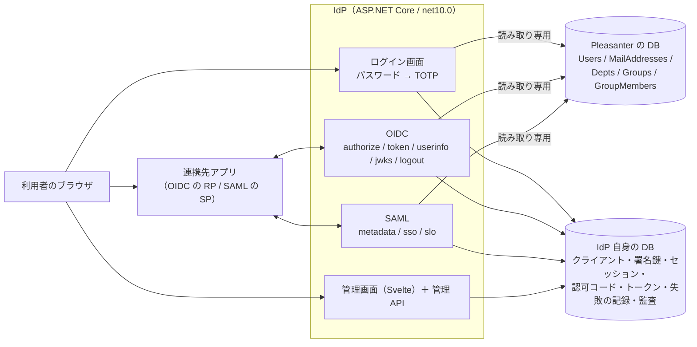
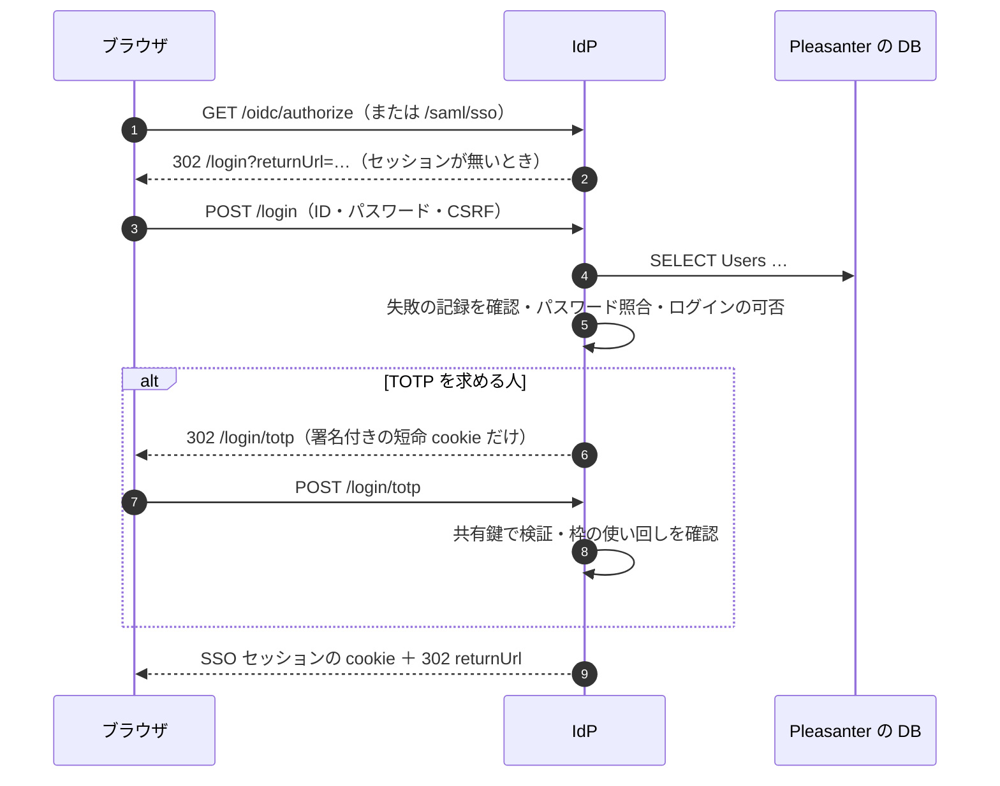

# アーキテクチャ方針

Pleasanter のユーザーを、そのまま SAML 2.0 / OpenID Connect（OIDC）の IdP として使えるようにする独立アプリの設計方針。

**決めたこと（2026-10-17）**

1. **Pleasanter の DB は読み取り専用で参照する。** 書き込まない。Pleasanter 本体は改造しない
2. **IdP 自身の状態は別の DB に持つ。** SQL Server / PostgreSQL / MySQL / SQLite（SQLite は簡易・検証用）
3. **TOTP は Pleasanter が持つ共有鍵（`Users.SecretKey`）をそのまま使う。** 認証アプリの再登録は要らない
4. **OIDC は自前実装**（Authorization Code + PKCE）。トークンの署名と検証だけ Microsoft.IdentityModel に任せる。
   **SAML はライブラリ（ITfoxtec.Identity.Saml2）に任せる。** XML 署名を自分で書かない
5. **管理画面は最初から作る。** 管理者は Pleasanter のユーザーで、IdP と同じログインで入る

## 全体像

## 1. Pleasanter の DB を読む

### 何を読むか

| 表 | 使う列 | 用途 |
| --- | --- | --- |
| `Users` | `TenantId` `UserId` `LoginId` `GlobalId` `Name` `UserCode` `Language` `TimeZone` `DeptId` `Disabled` `Lockout` `TenantManager` `ServiceManager` `Password` `PasswordExpirationTime` `LoginExpirationLimit` `LoginExpirationPeriod` `LastLoginTime` `SecretKey` `EnableSecretKey` `EnableSecondaryAuthentication` `DisableSecondaryAuthentication` | 認証・クレーム |
| `MailAddresses` | `OwnerId` `OwnerType`（`Users`）`MailAddress` `MailAddressId` | `email` クレーム・SAML の NameID（先頭が代表） |
| `Depts` | `TenantId` `DeptId` `DeptName` `Disabled` | `dept` クレーム |
| `Groups` / `GroupMembers` | `GroupId` `GroupName` `Disabled` / `GroupId` `UserId` `DeptId` | `groups` クレーム（本人が直接のメンバー、または所属部署がメンバーのもの） |

- 根拠: `_reference/Implem.Pleasanter/Implem.Pleasanter/App_Data/Definitions/Definition_Column/`（列の名前と型）、
  実機（`implem/pleasanter:1.5.9.0`、SQL Server）の `INFORMATION_SCHEMA.COLUMNS`（2026-10-17。列名・型とも一致）
- メールアドレスの `OwnerType` は `Users`（`Models/Users/UserModel.cs` の `OwnerType("Users")`）。
  同じ `OwnerId` でも `Groups` 宛ては別物なので、**`OwnerType` を必ず条件に入れる**
- グループの入れ子（`ChildGroup`）は辿らない

### 読み取り専用を守る方法

1. **アプリが発行する SQL は `SELECT` だけ**（`PleasanterUserStore`）。書き込む経路を作らない
2. **運用では読み取り専用の DB ユーザーを渡す**（[`導入-更新運用手順書.md`](導入-更新運用手順書.md)）。
   アプリが書かない設計でも、DB 側の権限で書けなくしておく
3. 連続失敗の回数・締め出し・使用済みの TOTP の枠は **IdP 自身の DB** に持つ。
   Pleasanter の `Lockout` / `LockoutCounter` は**尊重する（立っていれば通さない）が、書き換えない**

### パスワード

- Pleasanter は `SHA-512(UTF-8)` を 16 進小文字で `Users.Password` に保存する（ソルト無し）。
  根拠: `_reference/Implem.Pleasanter/Implem.Libraries/Utilities/Encryptions.cs` の `Sha512Cng`
- IdP は同じ計算で照合する（定数時間比較）。**IdP は保存形式を変えない・変えられない**
- パスワードが空のユーザー（外部認証だけのユーザー）は、パスワードでは入れない

### Pleasanter のログイン判定を引き継ぐもの

| 状態 | IdP の扱い | 根拠（`UserModel.cs`） |
| --- | --- | --- |
| `Disabled` | 通さない | `GetByCredentials` の `Disabled(false)` |
| `Lockout` | 通さない | `Authenticate` の `if (Lockout)` |
| `LoginExpirationLimit` / `LoginExpirationPeriod` + `LastLoginTime` | 期限切れなら通さない | `LoginExpired()` |
| `PasswordExpirationTime` | 期限切れなら通さず、Pleasanter での変更を案内する | `PasswordExpired()`（Pleasanter は変更画面を出すが、IdP は書き込めない） |

⚠️ **Pleasanter の初期管理者（`Administrator`）は、初回のログインでパスワードを変えるまで
`PasswordExpirationTime` が作成時刻になっている**（`Libraries/Initializers/UsersInitializer.cs`）。
先に Pleasanter でログインしてパスワードを変えること。

⚠️ **IP 制限（`ContractSettings` の許可 IP）と、LDAP / 外部の認証プロバイダは引き継がない。**

## 2. TOTP（二段階認証）

Pleasanter は TOTP の共有鍵を `Users.SecretKey`（Base32、20 バイト）に **平文で**保存し、
`EnableSecretKey` で登録済みかを持つ。検証は Otp.NET の `Totp(…, totpSize: 6)` で、30 秒・6 桁・SHA-1
（`UserModel.cs` の `VerifyTotp`、`UpdateSecretKey`）。IdP は **同じ鍵・同じ方式で検証する**ので、
Pleasanter で登録した認証アプリがそのまま使える。

### 求める条件（`IDP_TOTP_MODE`）

| 値 | 求める人 | 使いどころ |
| --- | --- | --- |
| `Auto`（既定） | Pleasanter で TOTP を**登録済み**（`EnableSecretKey` が有効で `SecretKey` がある）の人 | Pleasanter 側の設定を IdP へ写したくないとき |
| `Pleasanter` | Pleasanter の `SecondaryAuthentication.Mode` と、ユーザーごとの `EnableSecondaryAuthentication` / `DisableSecondaryAuthentication` に従う | Pleasanter 本体と同じ条件にしたいとき |

`Pleasanter` モードで、必須なのに未登録の人は **IdP では登録できない**（Pleasanter の DB へ書けない）ので、
ログインを通さず Pleasanter での登録を案内する。

### IdP が足している守り（Pleasanter 本体には無い）

- **同じ時間枠の使い回しを弾く。** 30 秒の間は同じ数字が通るので、盗み見られた数字がそのまま使える。
  IdP は通した枠をユーザーごとに覚え、同じか古い枠を断る（`TotpUsedSteps`）
- **パスワードと TOTP の失敗を同じ鍵で数える。** パスワードを知っている相手に、6 桁を総当たりさせない
- 許す枠は「前 `CountTolerances` 枠 + 後ろ 1 枠」。Pleasanter の `SecondaryAuthentication.CountTolerances` と同じ名前で読む

⚠️ メールによる二次認証（`NotificationType: Mail`）には対応しない。

## 3. ログインとセッション

- **パスワードが通っただけではセッションを作らない。** TOTP が要る人は、署名付きの短命な cookie
  （5 分）だけを持たせ、TOTP が通ってから作る
- セッションの本体は DB にある。cookie は署名付きのセッション ID だけ（`HttpOnly`・`SameSite=Lax`、
  Issuer が https なら `Secure`）。**ログインのたびに新しい ID を発行する**（セッション固定化の対策）
- 署名は `IDP_SECRET_KEY` から派生した鍵（HMAC-SHA256）。ASP.NET Core の Data Protection の鍵束を
  共有しなくても、複数インスタンスで動く
- 戻り先（`returnUrl`）は**同じオリジンの絶対パスだけ**（`//evil` や `/\evil`、スキーム付きは弾く）

## 4. OIDC

[`OIDC連携-運用手順書.md`](OIDC連携-運用手順書.md) に連携先の設定を書く。ここは設計の要点。

| 項目 | 方針 |
| --- | --- |
| フロー | Authorization Code のみ。implicit / hybrid は無い |
| PKCE | `S256` だけ（`plain` は受けない）。**公開クライアントは必須**、機密クライアントは任意（送ってきたら検証する） |
| リダイレクト URI | **完全一致**。ワイルドカードや前方一致は無い。http は localhost / ループバックだけ |
| 認可コード | 256 ビットの乱数。**ハッシュだけ DB に置く**。1 度しか使えない（条件付き UPDATE で消費）。再利用を検知したら、そのコードから出たトークンの系統を全て失効させる |
| リフレッシュトークン | `offline_access` のときだけ。**使うたびに新しいものへ替える**。古いものが来たら系統ごと失効 |
| ID トークン | RS256。`sub` は `Users.UserId`（ログイン ID の変更に追従する）。`amr`（`pwd` / `otp`）・`acr`（`pwd` / `mfa`）・`auth_time`・`sid`・`at_hash` |
| アクセストークン | JWT（`typ: at+jwt`）。UserInfo は署名・期限に加え、**発行元のセッションが失効していないか**を見る |
| 署名アルゴリズム | **RS256 だけを受ける**（`alg: none` や、公開鍵を HMAC の秘密に使わせるすり替えを許さない） |
| 認可応答 | `iss` を付ける（RFC 9207。認可サーバのすり替えへの対策） |
| ログアウト | RP-Initiated Logout。`id_token_hint` があれば直ちに、無ければ確認画面（強制ログアウトを防ぐ） |
| CORS | ブラウザ上の RP（SPA）のため。ディスカバリと JWKS は `*`、トークン・UserInfo・失効は**登録されたクライアントのリダイレクト URI のオリジンだけ**（資格情報を伴う要求は許さない）。ログイン・認可・管理 API・SAML には付けない |
| 対応しないもの | Back-Channel / Front-Channel Logout、動的クライアント登録、`request` オブジェクト、`form_post` |

クレームはスコープで絞る。`openid` だけなら `sub`、`profile` で `name` `preferred_username` `locale` `zoneinfo`
`dept` `tenant_id` `user_code` `tenant_manager` `service_manager`、`email` で `email`（`email_verified` は常に
`false`。**Pleasanter はメールアドレスの所有確認をしない**）、`groups` でグループ名の配列。
**パスワードのハッシュ・TOTP の共有鍵は、どのスコープでも載せない。**

## 5. SAML 2.0

[`SAML連携-運用手順書.md`](SAML連携-運用手順書.md) に連携先の設定を書く。

- IdP の EntityID は `{Issuer}/saml/metadata`（メタデータの URL と同じ）
- SP 起点の SSO（HTTP-Redirect / HTTP-POST の AuthnRequest → HTTP-POST の応答）と、SP 起点の単一ログアウト
- **応答は署名する。** アサーション・応答・両方を SP ごとに選べる（既定は両方）
- **宛先（ACS）は登録された URL だけ。** 要求が別の ACS を名乗っても従わない
- **要求は、ログインへ回す前に検証を済ませる。** 署名付きの要求は、登録された SP の証明書で検証する。
  署名必須の SP は、署名の無い要求を受け付けない
- ⚠️ ライブラリは **`Saml2Configuration.SignAuthnRequest` を立てないと、証明書を渡しても要求の署名を検証しない**
  （別の鍵で署名した要求も、改ざんした要求も通る）。IdP は署名があり証明書がある要求で必ずこれを立てる。
  結合テスト（`SamlEndToEndTests` の「改ざん」「別の鍵」）がこの退行を見張る
- 応答を作るときに NameID と属性の元を引き直し、**メールが無いのにメールを NameID に求められたら応答しない**
- 対応しないもの: IdP 起点の SSO、Artifact、アサーションの暗号化、他の SP への SLO の伝播

## 6. IdP 自身の DB

[`データモデル設計.md`](データモデル設計.md)。**シークレット・コード・トークンは値そのものを持たず、ハッシュだけ持つ。**
署名鍵の秘密鍵は `IDP_SECRET_KEY`（AES-GCM）で暗号化して持つ。

## 7. 管理画面

- 管理者は **Pleasanter のユーザー**。IdP のログイン（TOTP を含む）で入る。専用の管理者表は無い
- 既定は `ServiceManager`（システム管理者）。`IDP_ADMIN_ROLE=TenantManager` でテナント管理者以上へ広げられ、
  `IDP_ADMIN_LOGIN_IDS` でログイン ID を絞れる
- **管理 API は毎回、Pleasanter から今の状態を引き直す。** 管理者でなくなった人・無効化された人は、
  セッションが残っていても入れない
- 更新系は `X-IdP-Admin: 1` ヘッダと `Origin` の一致を要求する（CSRF 対策）。API の契約は
  [`管理API仕様.md`](管理API仕様.md)

## 8. 複数インスタンス

状態は全て DB にあり、インスタンス間で共有する鍵は `IDP_SECRET_KEY` だけ。ログイン失敗の締め出し・
TOTP の枠・認可コードの消費は DB の条件付き更新なので、複数インスタンスでも 1 回しか成功しない
（実機の 3 RDBMS で並列に当てて確認している）。署名鍵のキャッシュは最長 30 秒で、ローテーションに追随する。

IP ごとのレート制限（ログイン・トークン）はインスタンスごと（メモリ内）。**インスタンスの数だけ試せる**ので、
締め出しの本体は DB 側（上記）に置いている。

## 9. 参照元との関係

構成・規約・CI は VehicleVision.PleasanterTools.Questionnaire に準拠する。アンケート固有の部分
（回答・添付・メール・SAML の SP 側など）は持ち込んでいない。Pleasanter 本体（AGPL v3）は
サブモジュール `_reference/` として**事実確認のためだけ**に参照し、コードは取り込まない。
