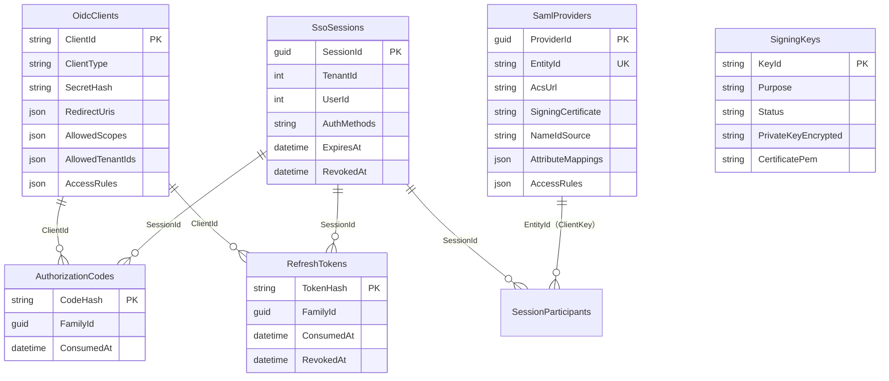

# データモデル設計

IdP 自身の DB（SQL Server / PostgreSQL / MySQL / SQLite）の表。**Pleasanter の DB には何も作らない。**
スキーマは FluentMigrator で管理する（`src/VehicleVision.PleasanterTools.IdentityProvider.Data/Migrations/`）。
起動時に自動で当たる（`IDP_DB_AUTO_MIGRATE`、既定 `true`）。

## 表

| 表 | 内容 | 備考 |
| --- | --- | --- |
| `OidcClients` | OIDC クライアントの登録 | `SecretHash` は SHA-256（256 ビットの乱数なので遅いハッシュは要らない）。公開クライアントは `NULL`。配列は JSON 文字列で持つ |
| `SamlProviders` | SAML の SP の登録 | `EntityId` は一意。`SigningCertificate` は SP の署名用証明書（PEM）。属性の対応表は JSON |
| `SigningKeys` | 署名鍵（OIDC 用・SAML 用） | **秘密鍵は `IDP_SECRET_KEY`（AES-GCM）で暗号化**して `PrivateKeyEncrypted` へ。`Status` は `active` / `retired`。退役した鍵は消すまで公開し続ける |
| `SsoSessions` | IdP へのログイン状態 | `AuthMethods` は `pwd,otp`。`RevokedAt` が入ると失効。掃除は期限から 2 日後（アクセストークンの寿命の上限 24 時間より長く残す） |
| `SessionParticipants` | そのセッションで、どの RP / SP へ発行したか | SLO の対応づけに使う（`Kind` は `oidc` / `saml`） |
| `AuthorizationCodes` | OIDC の認可コード | **コードの値は持たず、ハッシュだけ。** `ConsumedAt` が入ったあとに来たら再利用の疑い。`FamilyId` で、そこから出たトークンの系統を辿る |
| `RefreshTokens` | OIDC のリフレッシュトークン | 同上。使うたびに `ConsumedAt` を入れて新しい行を作る |
| `LoginFailures` | ログイン失敗の回数と締め出し | 鍵は小文字にしたログイン ID（**存在しない ID も同じ**）。Pleasanter の `LockoutCounter` とは別 |
| `TotpUsedSteps` | 使用済みの TOTP の時間枠 | ユーザーごとに最後の枠を 1 行。枠が進むときだけ更新（条件付き UPDATE） |
| `PendingRequests` | ログインの途中で預かる要求 | SAML の検証済みの要点を 30 分だけ。1 度しか取り出せない |
| `Core_AuditLogs`（Core.Data の共有表。M10005） | 認証・トークン発行・管理操作の記録 | 要求の本文には触れない。パスワード・シークレット・トークン・TOTP の数字は入れない。既定で 365 日（`IDP_AUDIT_RETENTION_DAYS`） |

## 時刻

**列に入っているのは常に UTC。** 4 つの RDBMS のいずれも時間帯を持たない列なので、読み出した値の
`DateTimeKind` は `Unspecified` になる。`DbTime` が書き込み時に秒未満を切り捨て（MySQL の丸めで「未来」に
なるのを避ける）・`Kind` を外し（Npgsql が時間帯変換するのを避ける）、読み出し時に UTC の印を付ける。
結合テスト（`時刻はUTCのまま往復しサーバの時間帯に左右されない`）が 4 RDBMS で見張っている。

## RDBMS ごとの注意

- **MySQL は表を utf8mb4 へ揃える。** FluentMigrator が作る表は、DB や接続の既定が utf8mb4 でも `utf8mb3` になり、
  絵文字や一部の漢字を保存できない（実機で確認）。初期スキーマ（`M0001`）が `CONVERT TO CHARACTER SET utf8mb4
  COLLATE utf8mb4_bin` を当てる。`_bin` は大文字小文字を区別する（PostgreSQL と揃う）
- **`LIKE` は小文字にして比べる。** PostgreSQL の `LIKE` は大文字小文字を区別するため、画面の絞り込みは
  両辺を `LOWER` にしている。`%` `_` `[` はエスケープ文字 `!` で逃がす
- **更新の代入順に依存する式がある**（`LoginFailures` の `FailedCount` / `LockedUntil`）。
  MySQL は左から順に更新後の値を見る。`LockedUntil` → `FailedCount` → `LastFailedAt` の順で書いて、
  3 つの RDBMS とも更新前の値で判定できるようにしている（`SecurityStores.cs` に注意書き）
- **SQLite は簡易・検証用。** 本番では使わない

## マイグレーションの番号

**番号は PR 間で重ならないよう、Issue を投げる時点で割り当てる**（[`ブランチ運用方針.md`](ブランチ運用方針.md)）。
⚠️ **FluentMigrator は同じ番号を 2 つ見つけても落ちず、片方を黙って飛ばす。**

## Pleasanter の DB を読む側

[`アーキテクチャ方針.md`](アーキテクチャ方針.md) の「Pleasanter の DB を読む」を参照。
IdP は **表を作らず、読むだけ**。列の名前・型は実機（SQL Server）と定義ファイルで確認している。
PostgreSQL / MySQL 版の Pleasanter の実スキーマは、同じ定義から作られるため列の名前は同じ（型は
`bit` → `boolean` / `tinyint(1)` など）。結合テストは同じ列名・同等の型の表を 4 RDBMS に作って確かめている。
