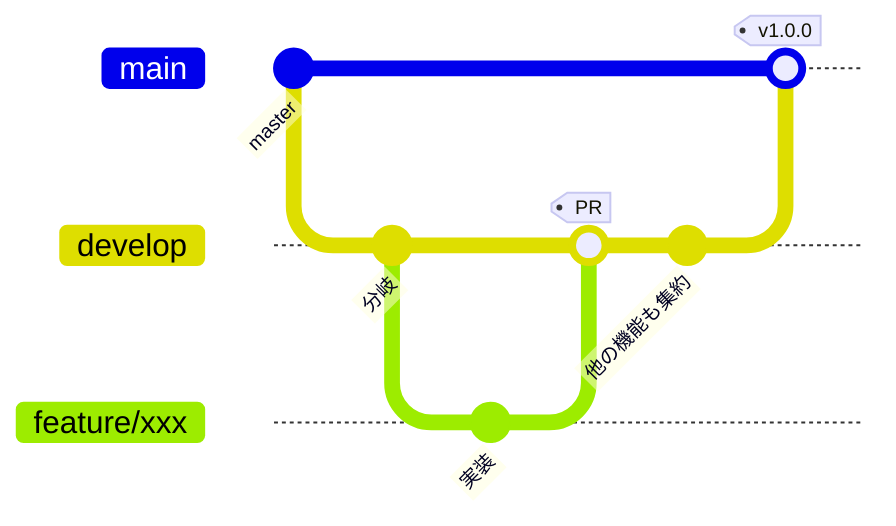

# ブランチ運用方針

どのブランチから分岐し、どこへ PR を向け、どこでリリースするか。
`VehicleVision.Dealer` の体系に合わせつつ、**本リポジトリの事情に合わせて変えた点は
理由を明記する。**

## ブランチの種類

| ブランチ | 役割 | 直接 push | 作業の base |
|---|---|---|---|
| `develop` | 開発を集約する | 不可 | **ここ** |
| `master` | リリース確定状態を保持する | 不可（PR 必須） | 原則不可 |
| 作業ブランチ | 機能追加・修正の単位。`feature/**` `fix/**` | 可 | — |

**既定ブランチは `develop`。** `develop` と `master` を合わせて「根幹ブランチ」と呼ぶ。

> **Dealer との違い。** Dealer は `develop_{バージョン}` / `master_{バージョン}` の
> バージョン別運用だが、**本リポジトリは単一系列でリリースするため版無しで運用する**
> （[`リリース手順書.md`](リリース手順書.md)）。
> 複数バージョンを並行保守する必要が出たら、そこで Dealer と同じ版別運用へ移行する。

## 全体の流れ



| 段階 | 操作 | 実行者 |
|---|---|---|
| 開発開始 | `develop` から作業ブランチを切る | 各開発者 |
| レビュー | 作業ブランチ → `develop` へ PR | 各開発者 |
| 取り込み | 必須チェック通過後に `develop` へマージ | 各開発者 |
| リリース準備 | `develop` → `master` へ PR | リリース担当 |
| リリース | `master` へタグを付けて Release | リリース担当 |

## 守ること

- **作業ブランチは `develop` から分岐させ、PR の base も `develop` にすること**

    ```bash
    git switch develop && git pull
    git switch -c feature/xxx
    gh pr create --base develop --draft --title "WIP: ..."
    ```

- **`master` を base にした PR を出さないこと**
    - リリース確定済みの状態が、レビュー前の変更で動くため
    - リリース時のみ `develop` → `master` の PR を出す（[`リリース手順書.md`](リリース手順書.md)）
    - `master` は PR 必須にしてあるため、直接 push は通らない
- **ドキュメントだけの変更でも PR を通すこと。** 直接 push で済ませない
- **PR 本文に `Closes #N` を書くこと**
- **ブランチ保護のバイパスを通常運用で使わないこと。** 管理者はバイパスできてしまう

## PR を積み上げるとき（stacked PR）

**先行する PR の変更が無いと成り立たない PR は、base を親の作業ブランチにすること。**
develop を base にして「先に #N をマージしてください」と本文へ書くのは、
**依存がどこにも宣言されていない状態。**

```bash
# 親: いつもどおり develop から分岐して PR を出す
git worktree add -b feature/189-auto-reply-mail \
    .worktrees/189-auto-reply-mail origin/develop
gh pr create --base develop

# 子: 親のブランチから分岐し、base も親のブランチにする
git worktree add -b feature/202-response-edit-link \
    .worktrees/202-response-edit-link \
    origin/feature/189-auto-reply-mail
gh pr create --base feature/189-auto-reply-mail
```

- **レビュー差分がその PR の分だけになる。** base を develop にすると親の変更まで差分に出て、
  「この PR で何が増えたのか」が読めなくなる
- **順番が GitHub 側から見える。** 本文の文章と、コンフリクトが起きるという事実だけで
  順番を表現しないこと

### ⚠️ 親がマージされたら、子は作り直す

**本リポジトリは squash マージなので、親の変更は develop 側では 1 つの新しいコミットになる。**
子のブランチには**同じ内容の元のコミット列**が残っているため、そのまま develop を
マージすると **add/add のコンフリクト**（同じファイルを両側が「新規追加」した扱い）になる。

```bash
# 子の固有コミットだけを、新しい develop の上へ乗せ直す
git log --oneline --no-merges origin/develop..HEAD   # 何を運ぶか確かめる
git checkout -B <ブランチ名>-v2 origin/develop
git cherry-pick <子の固有コミット>...
git push --force-with-lease origin HEAD:<元のブランチ名>
gh pr edit <子のPR番号> --base develop
```

- **base の付け替えが自動で起きることを前提にしない。**
  GitHub は親のブランチが消えると子の base を付け替えることがあるが、
  **中身の取り込みまではしない**

### 自動マージを armed にするのは、親が入ってから

**子の必須チェックが先に緑になると、順番を無視して入り得る。**

---

## 作業ツリー（worktree）の切り方

**別ブランチの作業は、メインツリーでブランチを切り替えるのではなく `git worktree` を
切って行うこと。** 並列で作業するときだけでなく、単独で 1 ブランチ触るときも同じ扱いにする。

**理由。** 1 つの作業ツリーでブランチを切り替えると、他の作業中の変更やビルド成果物
（`bin/` `obj/` `node_modules/` `_dist/`）を壊す。分岐元から直接 worktree を作れば、
**切り忘れによる誤ったブランチへのコミットも防げる。**

| 項目 | 決まり |
|---|---|
| 置き場所 | リポジトリ内の `.worktrees/` 配下（`.gitignore` 済み） |
| ディレクトリ名 | `{PR番号 または Issue番号}-{概要}` |
| 概要の書き方 | 英小文字のケバブケース。何の作業か分かる短い語 |
| 番号が無いとき | `unassigned-{概要}`。**採番できたらリネームすること** |

```bash
# Issue #12 の作業ツリーを、新しいブランチごと切る
git worktree add -b feature/12-answer-validator     .worktrees/12-answer-validator     origin/develop

# 既存ブランチのツリーを切る
git worktree add     .worktrees/34-rate-limit     feature/34-rate-limit

# 番号がまだ無いとき（採番できたらリネームする）
git worktree add -b fix/xxx     .worktrees/unassigned-login-timeout     origin/develop
```

- **番号を先頭に置くこと。** フォルダ名を見ただけでどの Issue / PR の作業か分かる状態を保つ
- **`unassigned-` のまま放置しないこと。** どの作業のツリーか追えなくなる
- 用が済んだツリーは `git worktree remove <パス>` で片付けること
    - 使用済み＝マージ済み、または作業を取りやめたもの
    - **未 push の変更があるツリーは消さないこと。** 退避するか残すかは利用者に確認する
    - **マージ済みかどうかは PR の状態と内容で判断すること。** squash マージのため
      `git cherry` や祖先判定は当てにならない

## 一時成果物の置き場所

- 調査メモ・生成したコマンドリスト・検証用スクリプトなど**その場限りの成果物は
  `temp/{yyyyMMdd}_{内容}/` に出すこと**
- `temp/` は `.gitignore` 済み。コミットしないこと
- リポジトリ直下や各プロジェクト配下へ直接置かないこと。消し忘れが混ざる

## CI の実行条件

**`develop` と `master` を合わせて「根幹ブランチ」と呼ぶ。**

| ワークフロー | ジョブ名（＝チェック名） | 実行契機 | 必須 |
|---|---|---|---|
| `.github/workflows/ci.yml` | `build-test` | 全ブランチへの push、根幹ブランチを対象とする PR | ○ |
| 同上 | `frontend` | 同上 | ○ |
| 同上 | `license-check`（`scripts/license-check.sh`） | 同上 | ○ |
| `.github/workflows/integration.yml` | `integration` | 根幹ブランチへの push、根幹ブランチを対象とする PR | ○ |
| `.github/workflows/pr-title-wip-check.yml` | `wip-title` | 根幹ブランチを対象とする PR（タイトルの編集も拾う） | ○ |
| `.github/workflows/pr-issue-link-check.yml` | `issue-link` | 根幹ブランチを対象とする PR（本文の編集も拾う）。止めずにコメントで知らせる | — |
| `.github/workflows/cla-check.yml` | `cla` | 根幹ブランチを対象とする PR（`pull_request_target`） | — |
| `.github/workflows/dependency-review.yml` | `dependency-review` | 根幹ブランチを対象とする PR | — |
| `.github/workflows/codeql.yml` | `codeql-preflight` | 全ブランチへの push、週次、手動 | — |
| 同上 | `Analyze (csharp)` | 同上 | — |
| 同上 | `Analyze (typescript)` | 同上 | — |
| 同上 | `codeql-summary` | 同上 | — |
| `.github/workflows/dependency-audit.yml` | `nuget-audit` | 全ブランチへの push、週次、手動 | — |
| 同上 | `npm-audit` | 同上 | — |
| 同上 | `notice-consistency`（`scripts/notice-check.sh`） | 同上 | ○ |
| `.github/workflows/markdown-lint.yml` | `markdown-lint`（`npm run lint:md`） | 全ブランチへの push、`develop` / `master` 向けの PR | — |
| `.github/workflows/release-run.yml` | `plan` / `run` | 手動のみ（`develop` から） | — |
| `.github/workflows/release.yml` | `verify` / `release` | `v*` タグの push、手動（dry-run） | — |

- **ジョブ名を変えないこと。** 必須ステータスチェックはチェック名で照合するため、
  改名すると「待ち続けるが永遠に来ない」状態になりマージできなくなる
    - 「必須」が `—` のものは ruleset へ登録していないため改名しても止まらないが、
      登録する日が来たときに困るので、やはり変えないこと
- **単体テストのジョブは結合テストを実行しない。** `IDP_INTEGRATION` を
  設定しないと何も検証せずに緑になるため、混ぜると「通った」と誤読する
- **結合テストは 1 ジョブにまとめて直列で回す。** 4 RDBMS を並列のジョブへ分けると、
  同じテーブルを触るテストが互いの行を消し合う

### CodeQL（`codeql.yml`）

**advanced setup（ワークフローを自分で持つ形）で回す。** GitHub 管理の default setup は
実行契機もクエリスイートも制御できず、上表の方針と食い違うため使わない。

| 項目 | 内容 |
|---|---|
| 対象言語 | `csharp`（実ビルドをトレース）、`javascript-typescript`（ビルド無し） |
| クエリスイート | `security-extended`（`.github/codeql/codeql-config.yml`） |
| 結果の置き場所 | Security タブ > Code scanning。**ジョブのログには出ない** |

- ⚠️ **リポジトリで GitHub Advanced Security（Code Security）が有効でないと動かない。**
  本リポジトリは internal のため、無効のままでは解析結果の送信が
  `Advanced Security must be enabled for this repository to use code scanning.` で失敗する
    - **整うまでは `codeql-preflight` ジョブが解析を飛ばす。** 全ブランチの push で
      回すため、失敗させ続けると「CI が赤いのが普通」の状態になる。
      飛ばしたことは警告とジョブ要約に残るので、**`skipped` を「合格」と読まないこと**
    - 設定はリポジトリの Settings から行う。**有効にするまでこのリポジトリの
      コードは静的解析されていない**
- ⚠️ **アラートの題名と解説は英語のまま。** CodeQL のクエリと解説は GitHub 提供の
  クエリパックに埋め込まれており、日本語へ差し替える口が無い。
  **却下（dismiss）するときの理由は日本語で書くこと**
- ⚠️ **`.svelte` は解析されない。** CodeQL の JavaScript/TypeScript 抽出器の対象外。
  **画面のロジックは `.ts` 側へ置くこと。** `.svelte` へ寄せるほど守備範囲が狭くなる
- **C# は `build-mode: manual` で実ビルドをトレースする。** ビルド無し（`none`）でも
  解析できるが精度が落ちる。`autobuild` にしないのは、ソリューションが `.slnx` で
  自動検出できる保証が無いため

### 依存の脆弱性検査（`dependency-audit.yml`）

| 対象 | 手段 |
|---|---|
| NuGet | `scripts/nuget-vulnerable-check.sh`（`dotnet list package --vulnerable --include-transitive`） |
| npm | `npm audit --audit-level=moderate` と `npm audit signatures` |
| `NOTICE` の整合 | `scripts/notice-check.sh` |

- ⚠️ **`dotnet list package --vulnerable` は、脆弱性を見つけても終了コード 0 を返す。**
  そのまま CI のステップにすると永遠に緑になる。JSON を読んで落とすスクリプトを挟んでいる
- **このワークフローでは `actions/dependency-review-action` を使わない。** GitHub の依存関係グラフを前提にする
  action で、internal リポジトリでは Advanced Security の有効化が要る。
  上記 2 つは GitHub 側の有効化状態に関係なく動く
    - PR で**これから入る**依存（脆弱性とコピーレフトのライセンス）は、別の `dependency-review.yml` が
      この action で見ている（必須にはしていない）
- **週次でも回す。** 脆弱性はこちらのコードが変わらなくても増える

### まだ CI に載せていないもの

| 対象 | 理由 |
|---|---|
| `scripts/smoke.sh` | 起動している本アプリのコンテナが要る |
| Pleasanter 本体の実機（`implem/pleasanter`）を使う試験 | 検証環境の起動に数分かかる。**結合テストと単体テストでは回らない**ので、導入するまでこの範囲は CI で検証されていない |

### リリース実行（`release-run.yml`）

**`major` / `minor` / `patch` を選ぶだけで、採番からタグ push まで通す。**
詳細は [`リリース手順書.md`](リリース手順書.md)。

- **手動起動のみ。`develop` から回す。** 対象は常に `develop` → `master` で、
  別のブランチから起動されると指定と実際が食い違うため落とす
- ⚠️ **`my-repo-automation-bot`（GitHub App）のトークンで動く。`GITHUB_TOKEN` では動かない。**
  `GITHUB_TOKEN` が作った PR には CI が回らず、**必須ステータスチェックが
  永久に pending になってマージできない**。**Dealer と同じ立て付け**で、
  `vars.MY_REPO_AUTOMATION_BOT_CLIENT_ID` と
  `secrets.MY_REPO_AUTOMATION_BOT_PRIVATE_KEY` から installation token を発行する
- ⚠️ **`develop` → `master` は squash しない。** squash すると `master` の履歴が
  `develop` と別物になり、次のリリースの PR が過去の変更まで抱える
- **マージの待ちは GitHub の auto-merge に任せる。** こちらで合否を判定して
  マージすると、ruleset の判定を二重に実装することになり食い違う

### 参照ソースのオンデマンド取得

Pleasanter 本体は AI の事実確認専用で、CI は使わない。
読む前に `bash scripts/sync-reference.sh` で上流 `main` の先頭を取得し、
完全な SHA・固定リンク・参照日を記録する。実機未検証ならその旨も残す。
既定先・共有先の扱いは [`_reference/README.md`](../_reference/README.md) を参照する。

- 本体の gitlink・日次更新 workflow・更新用スクリプトを廃止する。
  既存の更新ブランチ・Draft PR・Issue は今回操作せず、後でまとめて整理する
- `submodules: false` と既存の除外設定を維持し、CI から本体を取得しない。
  取得処理のローカル回帰テストと隔離検査は既存 `license-check` ジョブで行う
- 検証環境の `implem/pleasanter:1.5.9.0` と過去の仕様確認記録は自動更新しない。
  `main` はリリース前の変更を含むため、ソースの同期と実機の確認を区別する
- GitHub 設定・ルールセット・App・資格情報は変更しない。
  リリースや patch 更新など他用途の bot は維持する

出典（2026-10-27 参照）:
[Template の配布手順（3312f003fbe9827090e20bc643800824bdf30e22）](https://github.com/vehiclevisionjp/VehicleVision.PleasanterTools.Template/blob/3312f003fbe9827090e20bc643800824bdf30e22/_documents/参照ソースのオンデマンド取得への配布手順.md)。

### 依存の更新（Dependabot）

`.github/dependabot.yml` で nuget / npm / github-actions を週次で見る。
**base は `develop`。** 更新 PR にも上表の必須チェックが適用される。

**寛容ライセンス（MIT / BSD 系 / Apache-2.0）以外へ変わった依存は入れないこと**
（[`LICENSING.md`](../LICENSING.md)）。採用を続けるなら [`NOTICE`](../NOTICE) を直す。

## ブランチ保護

**Repository rulesets で設定する**（classic branch protection は使わない）。

| ruleset | 対象 | ルール |
|---|---|---|
| `develop-protection` | `refs/heads/develop` | 削除禁止、force push 禁止、**必須ステータスチェック** |
| `master-protection` | `refs/heads/master` | 上記に加えて **PR 必須**（承認 0 件） |
| `release-tag-protection` | `refs/tags/v*` | 削除禁止、force push 禁止 |

- **`master` の PR 必須は承認数 0。** レビューを強制するためではなく、
  リリース確定ブランチへ直接 push が入らないようにするための設定
- **リポジトリ管理者（Repository role の Admin）はバイパスできる。** 緊急時の復旧経路を塞がないため。
  **通常運用でバイパスを使わないこと**
    - **新しいリポジトリでは、ruleset の bypass の対象を `GET /repos/{owner}/{repo}/rulesets/{id}` で確かめること。**
      自動化 bot（`my-repo-automation-bot`）は bypass に入れない。
      リリース実行は bot がバイパスせず、必須チェックが緑になるのを auto-merge で待つ
- `delete_branch_on_merge` を有効にする。マージすると head ブランチが自動削除される

### 必須ステータスチェック

[CI の実行条件](#ci-の実行条件)のうち次のジョブ名を登録済み
（ruleset の API で確かめること）。

| チェック名 | 出どころ |
|---|---|
| `build-test` | `.github/workflows/ci.yml` |
| `frontend` | 同上 |
| `license-check` | 同上 |
| `integration` | `.github/workflows/integration.yml` |
| `wip-title` | `.github/workflows/pr-title-wip-check.yml` |
| `notice-consistency` | `.github/workflows/dependency-audit.yml` |

**CodeQL と依存の脆弱性検査（NuGet・npm・`dependency-review.yml`）は、あえて必須にしていない。**
どちらも「こちらのコードが変わらなくても赤くなる」検査で、
新たに公開された脆弱性やクエリパックの更新で既存コードが引っかかった瞬間、
**その修正 PR 自体がマージできなくなる。** 門番ではなく、気付くための仕掛けとして扱う。

**参照ソースの日次更新は廃止した。** 必要時に同期し、CI には本体取得を追加しない。

- **登録したジョブ名は以後変更しない**（必須チェックの名前と一致している必要がある）
- `strict_required_status_checks_policy` は無効。
  マージ前に base の最新を取り込み直すことまでは求めない
- **ruleset を触るときは、まず現状を GET して差分だけ足すこと。**
  `PUT /repos/{owner}/{repo}/rulesets/{id}` は**送らなかったルールを消す**
  （<https://docs.github.com/en/rest/repos/rules>）

## ラベルと Milestone

**ラベル名は `{区分番号}-{区分名}:{値}` の形式**（Dealer と同じ体系）。

> **未整備。** 運用を始める時点で Dealer の体系から必要なものを移植すること。
