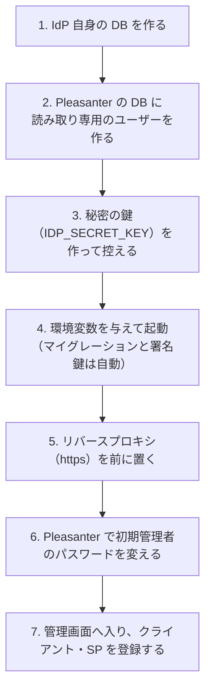

# 導入・更新 運用手順書

IdP を導入し、更新し、戻すための手順。設定の一覧は [`設定パラメータ一覧.md`](設定パラメータ一覧.md)。

## 導入の流れ



### 1. IdP 自身の DB を作る

**Pleasanter の DB とは別のデータベース**にする（同じ RDBMS サーバの中でよい）。
Pleasanter の DB へ IdP の表を足さない。このユーザーはスキーマの変更（マイグレーション）をするので、
**そのデータベースの所有者（DDL を実行できる権限）** にする。

```sql
-- SQL Server（SSMS / sqlcmd）
CREATE DATABASE [IdentityProvider];
```

```bash
# PostgreSQL
createdb -U postgres idp
```

```sql
-- MySQL（文字集合は utf8mb4 にする）
CREATE DATABASE idp CHARACTER SET utf8mb4 COLLATE utf8mb4_0900_as_cs;
```

- **データベース自体はアプリが作らない**（マイグレーションは表だけを作る）
- MySQL の表は、アプリが `utf8mb4_bin` へ揃える（[`データモデル設計.md`](データモデル設計.md)）

### 2. Pleasanter の DB に読み取り専用のユーザーを作る

**アプリが書き込まない設計でも、DB 側の権限で書けなくしておく。** 読む表は 5 つだけ
（`Users` `MailAddresses` `Depts` `Groups` `GroupMembers`）。

```sql
-- SQL Server
CREATE LOGIN [idp_reader] WITH PASSWORD = N'（強いパスワード）';
USE [Implem.Pleasanter];
CREATE USER [idp_reader] FOR LOGIN [idp_reader];
GRANT SELECT ON OBJECT::dbo.[Users]         TO [idp_reader];
GRANT SELECT ON OBJECT::dbo.[MailAddresses] TO [idp_reader];
GRANT SELECT ON OBJECT::dbo.[Depts]         TO [idp_reader];
GRANT SELECT ON OBJECT::dbo.[Groups]        TO [idp_reader];
GRANT SELECT ON OBJECT::dbo.[GroupMembers]  TO [idp_reader];
```

```sql
-- PostgreSQL（スキーマ名は Pleasanter が作ったものに合わせる。public の例）
CREATE ROLE idp_reader LOGIN PASSWORD '（強いパスワード）';
GRANT CONNECT ON DATABASE "Implem.Pleasanter" TO idp_reader;
GRANT USAGE ON SCHEMA public TO idp_reader;
GRANT SELECT ON "Users", "MailAddresses", "Depts", "Groups", "GroupMembers" TO idp_reader;
```

```sql
-- MySQL
CREATE USER 'idp_reader'@'%' IDENTIFIED BY '（強いパスワード）';
GRANT SELECT ON `Implem.Pleasanter`.`Users`         TO 'idp_reader'@'%';
GRANT SELECT ON `Implem.Pleasanter`.`MailAddresses` TO 'idp_reader'@'%';
GRANT SELECT ON `Implem.Pleasanter`.`Depts`         TO 'idp_reader'@'%';
GRANT SELECT ON `Implem.Pleasanter`.`Groups`        TO 'idp_reader'@'%';
GRANT SELECT ON `Implem.Pleasanter`.`GroupMembers`  TO 'idp_reader'@'%';
```

⚠️ **上の SQL のうち、SQL Server は実機（Pleasanter 1.5.9.0 の既定のスキーマ `dbo`）で表と列の名前を確認した。
PostgreSQL と MySQL は未検証**（データベース名・スキーマ名は導入先の Pleasanter の設定に合わせて直すこと）。
接続して `SELECT COUNT(*) FROM "Users"` が通ること、`UPDATE` が拒否されることを、導入時に 1 度試す。

**パスワードの変更は IdP からはできない**（IdP はこのユーザーでは書けない）。Pleasanter で行う。

### 3. 秘密の鍵を作って控える

```bash
dotnet VehicleVision.PleasanterTools.IdentityProvider.Web.dll --generate-secret-key
```

- 出力（Base64 の 32 バイト）を `IDP_SECRET_KEY`（または `Service.local.json` の `SecretKey`）に設定する。
  **Key Vault などへ置き、控えを取ること。**
- **単一インスタンスなら、設定しなくても動く。** 無いときは起動時に新しい鍵を作り、`Service.local.json`（git 管理外）へ
  保存して、警告をログへ出す。**その鍵の控えを必ず取ること。** 作れるのは、IdP の DB に署名鍵がまだ無いときだけ
  （鍵を失った DB で作り直すと署名鍵が読めなくなるので、作った鍵を消して起動を止める）
- **複数インスタンス・使い捨てのファイルシステム（コンテナなど）では、必ず明示的に与える。**
  インスタンスごとに別の鍵ができる、再作成で鍵が消える、といった事故になる
- **失うと、保存した署名鍵が復号できず起動に失敗する。** その場合は下の「鍵を失ったとき」。
- 全インスタンスで同じ値にする（複数インスタンスで署名鍵と cookie の署名を共有するため）

### 4. 起動する

必須の環境変数（[`設定パラメータ一覧.md`](設定パラメータ一覧.md)）。**配置先ごとの与え方（systemd・IIS・Windows・Docker・Kubernetes）は、下の「設定の与え方（配置先ごと）」。**

```bash
export IDP_ISSUER=https://idp.example.com
export IDP_SECRET_KEY='…'
export IDP_DB_PROVIDER=PostgreSql
export IDP_DB_CONNECTIONSTRING='Host=…;Database=idp;Username=…;Password=…;SSL Mode=VerifyFull;Root Certificate=/etc/ssl/db-ca.pem'
export IDP_PLEASANTER_DB_PROVIDER=SqlServer
export IDP_PLEASANTER_DB_CONNECTIONSTRING='Server=…;Database=Implem.Pleasanter;User Id=idp_reader;Password=…;Encrypt=True'
dotnet VehicleVision.PleasanterTools.IdentityProvider.Web.dll
```

- 初回の起動で、**マイグレーション（表の作成）と署名鍵（OIDC 用・SAML 用）の生成が自動で行われる。**
  ログに `Database migration completed successfully.` が出る
- **DB への接続は暗号化と、相手の証明書の確認を求める。** 次の指定では起動しない（検証環境だけ
  `IDP_DB_ALLOW_INSECURE=true` / `IDP_PLEASANTER_DB_ALLOW_INSECURE=true` で緩められる）。
  自己署名の証明書を使う DB には、その CA を信頼させるのが本筋
    - SQL Server: `Encrypt=False`、`TrustServerCertificate=True`（暗号化そのものは常に立てる）
    - PostgreSQL: `SSL Mode` が `Disable` / `Allow` / `Prefer` / `Require`（`VerifyCA` か `VerifyFull` にする）
    - MySQL: `SslMode` が `None` / `Disabled` / `Preferred` / `Required`（`VerifyCA` か `VerifyFull` にする）
- 動作確認: `GET /healthz`（生存）→ 200、`GET /ready`（IdP 自身の DB へ繋がるか）→ 200、
  `GET /.well-known/openid-configuration` → 200

### 5. リバースプロキシ

**IdP は TLS を終わらせるプロキシの後ろに置く。** ブラウザとの通信は https にする
（cookie の `Secure` と、`iss` の https が前提）。

- **`IDP_ISSUER` はプロキシの外から見える URL にする。**（SAML の EntityID と OIDC の `iss` は、
  後から変えると連携先を全て直すことになる）
- 転送ヘッダを信じるプロキシの CIDR を `IDP_FORWARDED_NETWORKS` に書く。**書かないと信じない**
  （送信元 IP が全てプロキシのものに見え、IP ごとのレート制限が効かなくなる）
- サブパスで置くとき（例 Pleasanter と同じホストの `/idp`）は `IDP_PATH_BASE=/idp` にして、
  `IDP_ISSUER` もサブパス込みにする。**設定した経路の外には応答しない**（`/healthz` `/ready` を除く）
- `/healthz` と `/ready` は、プロキシを通らずに直接当てる（コンテナのヘルスチェック・Kubernetes の probe）。
  外へ見せたくなければ `IDP_HEALTH_NETWORKS` で送信元を絞る

```nginx
location /idp/ {
    proxy_pass         http://idp:8080/;
    proxy_set_header   Host $host;
    proxy_set_header   X-Forwarded-For $remote_addr;
    proxy_set_header   X-Forwarded-Proto $scheme;
}
```

（上は例。`IDP_PATH_BASE` を使うなら、`proxy_pass` でサブパスを剥がさず、そのまま渡す。）

### 6. 最初の管理者

Pleasanter の初期管理者 `Administrator` は、**初回のログインでパスワードを変えるまで**
パスワードの有効期限が切れた状態になっている。先に Pleasanter でログインして変える。

IdP の管理画面へ入れるのは既定で **`TenantManager`（テナント管理者以上）**。`Administrator` は
`TenantManager` を持つので、そのまま入れる。**入れる人を絞るときは、`Admin.json`（または環境変数）で、
ログイン ID（`LoginIds`）や、ユーザー・組織・グループの `Include` / `Exclude` を指定する**
（[`設定パラメータ一覧.md`](設定パラメータ一覧.md) の `Admin.json`）。管理画面からは変えられない。
システム管理者（`ServiceManager`）だけに限るなら `Role=ServiceManager`。

### 7. 連携先を登録する

管理画面（`{Issuer}/admin`）から登録する。[`OIDC連携-運用手順書.md`](OIDC連携-運用手順書.md)、
[`SAML連携-運用手順書.md`](SAML連携-運用手順書.md)。

## 設定の与え方（配置先ごと）

設定は **環境変数** と **`App_Data/Parameters/{名前}.local.json`（git 管理外）** のどちらでも、両方でも与えられる
（優先は `.local.json` ＞ 環境変数 ＞ 同梱の `.json`。[`設定パラメータ一覧.md`](設定パラメータ一覧.md)）。
**実値（接続文字列・秘密の鍵）を入れた置き場は、IdP を動かすアカウントだけが読めるようにする。**

- 環境変数は **`IDP_` で始まる名前**（一覧にあるもの）。`Admin__Include__Users__0` のような階層の名前では読まない
- 起動のログに、読んだ設定ファイルが出る（`IDP_PARAMETERS_FOUND`）。**「設定したのに効かない」ときは、まずここを見る**
  （置き場を間違えても、黙って既定で動いてしまうため）
- 待ち受けは `ASPNETCORE_URLS`（例 `http://127.0.0.1:8080`）で決める。プロキシの後ろに置くなら、外へ開けない
- 手順は下のとおりだが、**Windows・IIS・systemd・Kubernetes の各手順は、この IdP では実機で確かめていない**
  （環境の標準の手順に沿って書いてある）。差異があれば実機に合わせて直すこと

### Linux（systemd）

専用のアカウントで動かし、環境変数は `EnvironmentFile` へ置く。

```bash
sudo useradd --system --home /opt/idp --shell /usr/sbin/nologin idp
sudo install -d -o root -g idp -m 0750 /etc/idp
sudoedit /etc/idp/idp.env            # 下の例。KEY=VALUE を 1 行に 1 つ（export は付けない）
sudo chown root:idp /etc/idp/idp.env && sudo chmod 0640 /etc/idp/idp.env
```

```ini
# /etc/idp/idp.env
IDP_ISSUER=https://idp.example.com
IDP_SECRET_KEY=…
IDP_DB_PROVIDER=PostgreSql
IDP_DB_CONNECTIONSTRING=Host=…;Database=idp;Username=…;Password=…;SSL Mode=VerifyFull
IDP_PLEASANTER_DB_PROVIDER=SqlServer
IDP_PLEASANTER_DB_CONNECTIONSTRING=Server=…;Database=Implem.Pleasanter;User Id=idp_reader;Password=…;Encrypt=True
IDP_FORWARDED_NETWORKS=127.0.0.1/32
ASPNETCORE_URLS=http://127.0.0.1:8080
```

```ini
# /etc/systemd/system/idp.service
[Unit]
Description=Identity Provider for Pleasanter
After=network-online.target

[Service]
User=idp
WorkingDirectory=/opt/idp
EnvironmentFile=/etc/idp/idp.env
ExecStart=/usr/bin/dotnet /opt/idp/VehicleVision.PleasanterTools.IdentityProvider.Web.dll
Restart=on-failure

[Install]
WantedBy=multi-user.target
```

```bash
sudo systemctl daemon-reload && sudo systemctl enable --now idp
journalctl -u idp -f                 # 起動のログ（読んだ設定ファイル・マイグレーション）
```

- `EnvironmentFile` の値は、**引用符で囲まず**そのまま書く（接続文字列の `;` や `=` を含んでよい）
- ファイルで与えるなら `/opt/idp/App_Data/Parameters/Rds.local.json` などを `idp` だけが読める権限（0600）で置く。
  **`SecretKey` を自動で作らせるなら、`idp` がそのフォルダへ書ける必要がある**（読み取り専用にするなら、明示的に与える）

### Windows Server（IIS）

**ASP.NET Core Hosting Bundle を入れた IIS** で動かす（IIS が TLS を終わらせる。`IDP_ISSUER` は IIS の外から見える URL）。
環境変数は、次のいずれかで **アプリケーションプールへ**与える。

1. **アプリケーションプールの環境変数**（推奨。サイトのファイルに実値が残らない）

    ```powershell
    Import-Module WebAdministration
    $pool = 'idp'
    $values = @{
        IDP_ISSUER = 'https://idp.example.com'
        IDP_SECRET_KEY = '…'
        IDP_DB_PROVIDER = 'SqlServer'
        IDP_DB_CONNECTIONSTRING = 'Server=…;Database=idp;User Id=…;Password=…;Encrypt=True'
        IDP_PLEASANTER_DB_PROVIDER = 'SqlServer'
        IDP_PLEASANTER_DB_CONNECTIONSTRING = 'Server=…;Database=Implem.Pleasanter;User Id=idp_reader;Password=…;Encrypt=True'
    }
    foreach ($name in $values.Keys) {
        & "$env:windir\system32\inetsrv\appcmd.exe" set config -section:system.applicationHost/applicationPools `
            "/+[name='$pool'].environmentVariables.[name='$name',value='$($values[$name])']" /commit:apphost
    }
    Restart-WebAppPool $pool
    ```

2. **`web.config` の `environmentVariables`**（発行物の `web.config` の `<aspNetCore>` の中）。実値が入るので、
   **サイトのフォルダを IdP のアプリケーションプールと管理者だけが読める権限にする**

    ```xml
    <aspNetCore processPath="dotnet" arguments=".\VehicleVision.PleasanterTools.IdentityProvider.Web.dll" hostingModel="inprocess">
      <environmentVariables>
        <environmentVariable name="IDP_ISSUER" value="https://idp.example.com" />
      </environmentVariables>
    </aspNetCore>
    ```

3. **設定ファイル**（`App_Data\Parameters\Rds.local.json` など）。フォルダの権限を、アプリケーションプールの ID
   （`IIS AppPool\idp`）と管理者だけにする

    ```powershell
    icacls 'C:\inetpub\idp\App_Data\Parameters' /inheritance:r /grant 'IIS AppPool\idp:(OI)(CI)M' 'Administrators:(OI)(CI)F'
    ```

- **システム全体の環境変数（`setx /M`）でも与えられるが、全サイト・全アカウントから見える**ので、実値には向かない。
  変えたあとは IIS（`iisreset`）を再起動しないと、動いているプロセスに届かない
- 転送ヘッダを信じるプロキシが IIS 自身なら、`IDP_FORWARDED_NETWORKS=127.0.0.1/32,::1/128`（同じ機械から来る）
- ログは、イベントビューアーか、`web.config` の `stdoutLogEnabled`（原因調査のときだけ。実値がログへ出ない設計だが、調べ終えたら切る）

### Windows Server（IIS なしで動かす）

この IdP は **Windows サービスとして直接は動かない**（`UseWindowsService` に対応していない）。IIS を使うか、
サービス化の道具（NSSM・WinSW など）で包む。環境変数は、その道具の設定か、ユーザー環境変数で与える。

```powershell
# 試しに手で動かす（この PowerShell の中だけ有効）
$env:IDP_ISSUER = 'http://localhost:8081'
$env:IDP_SECRET_KEY = '…'
$env:IDP_DB_PROVIDER = 'Sqlite'
$env:IDP_PLEASANTER_DB_CONNECTIONSTRING = 'Server=…;Database=Implem.Pleasanter;User Id=idp_reader;Password=…;Encrypt=True'
dotnet .\VehicleVision.PleasanterTools.IdentityProvider.Web.dll
```

- サービスを動かすアカウント（専用のサービスアカウント）だけが読める場所へ、`.local.json` を置く
- `setx` は **新しく起動するプロセス**にだけ効く（動いているサービスには届かない）。サービスを再起動する

### コンテナ（オンプレの Docker・Compose）

```bash
docker run -d --name idp -p 127.0.0.1:8080:8080 --env-file /etc/idp/idp.env idp
```

```yaml
# compose.yaml（実値は env_file へ。compose.yaml へ直接書かない）
services:
  idp:
    image: idp
    env_file: /etc/idp/idp.env
    ports: ["127.0.0.1:8080:8080"]
    restart: unless-stopped
```

- `--env-file` / `env_file` のファイルは、**`KEY=VALUE`**（`export` なし。引用符で囲まない）で、権限を絞る（0600）
- **イメージには実値を入れない。** 環境変数のかわりに、設定ファイルをマウントしてもよい

    ```bash
    docker run -v /etc/idp/Rds.local.json:/app/App_Data/Parameters/Rds.local.json:ro … idp
    ```

- **コンテナは非 root で、`/app` へ書けない。** そのため `SecretKey` を自動では作れず、起動が止まる。**コンテナでは必ず
  `IDP_SECRET_KEY` を与える**（`docker run --rm idp --generate-secret-key` で作れる。控えを取る）
- **Docker secrets は `IDP_*_FILE` で渡せる**（下の「値をファイルから読む」）

### 値をファイルから読む（Docker secrets・Kubernetes の Secret のマウント）

**どの設定も、`IDP_X` のかわりに `IDP_X_FILE=ファイルのパス` で与えられる。** IdP はそのファイルの中身を `IDP_X` の値として読む
（Docker 公式イメージなどと同じ慣習）。環境変数にも `docker inspect` にも実値が出ない。

```yaml
# compose.yaml（Docker Swarm / Compose の secrets。実値は secrets のファイルへ）
services:
  idp:
    image: idp
    environment:
      IDP_ISSUER: https://idp.example.com
      IDP_SECRET_KEY_FILE: /run/secrets/idp_secret_key
      IDP_DB_CONNECTIONSTRING_FILE: /run/secrets/idp_db_connection
      IDP_PLEASANTER_DB_CONNECTIONSTRING_FILE: /run/secrets/idp_pleasanter_db_connection
    secrets: [idp_secret_key, idp_db_connection, idp_pleasanter_db_connection]
secrets:
  idp_secret_key: { file: /etc/idp/secrets/secret_key }
  idp_db_connection: { file: /etc/idp/secrets/db_connection }
  idp_pleasanter_db_connection: { file: /etc/idp/secrets/pleasanter_db_connection }
```

- **ファイルの中身が値そのもの**。**末尾の改行だけ**を落とす（先頭・途中の空白は値の一部）
- **`IDP_X` と `IDP_X_FILE` の両方を与えたら、起動で止める**（どちらが効くか曖昧なため）。
  **ファイルが無い・読めない・空のときも止める**（黙って既定へ落とすと、鍵や接続先が変わったことに気付けない）。
  エラーにはパスだけを出し、値は出さない
- **IdP を動かすアカウントが読める権限にする。** コンテナは非 root（`$APP_UID`）。Swarm の secrets は既定で誰でも読めるが、
  Compose のファイル由来の secrets や Kubernetes のマウントは、`uid` / `mode`（Kubernetes は `defaultMode` と `fsGroup`）で読めるようにする
- `IDP_` で始まり `_FILE` で終わる環境変数だけが対象（`Admin__Include__Users__0` のような階層の名前は対象外）。
  `.local.json` はこれらより強い（同じ設定が両方にあれば `.local.json` が勝つ）
- 手元の確認は `docker run --rm -e IDP_SECRET_KEY_FILE=/s -v ./key:/s:ro idp …`

### Kubernetes（オンプレ）

実値は `Secret` へ置き、環境変数かファイルとして渡す。

```yaml
env:
  - name: IDP_SECRET_KEY
    valueFrom: { secretKeyRef: { name: idp, key: secret-key } }
  - name: IDP_DB_CONNECTIONSTRING
    valueFrom: { secretKeyRef: { name: idp, key: db-connection } }
  - name: IDP_ISSUER
    value: https://idp.example.com
```

- 複数のレプリカは、**同じ `IDP_SECRET_KEY` を必ず明示する**（自動生成はレプリカごとに別の鍵になる）
- Secret をファイルとしてマウントして `IDP_SECRET_KEY_FILE=/etc/idp/secrets/secret-key` で渡してもよい（上の「値をファイルから読む」）
- `/healthz`（生存）と `/ready`（DB 接続）を probe に使う

## コンテナ（Docker）

```bash
docker build -t idp .
docker run --rm -p 8080:8080 -e IDP_… idp
```

- 実行は非 root（`USER $APP_UID`）。待ち受けは 8080
- 設定ファイルの既定値は `App_Data/Parameters/*.json` として同梱される。**実値は環境変数で与える**
- 検証環境一式（Pleasanter・3 種類の RDBMS・IdP）は [`開発環境.md`](開発環境.md)

## 更新

1. **新しい版の配置物（または新しいイメージ）へ差し替えて、再起動する。**
   マイグレーションは起動時に自動で当たる（排他を取るので、複数インスタンスが同時に起動してもよい）
2. 自動で当てたくない運用（DB の管理者が手で当てる）は `IDP_DB_AUTO_MIGRATE=false` にして、
   先に `--migrate` で当てる。当てないまま起動すると、未適用の一覧を出して止まる

```bash
dotnet …Web.dll --migrate-status   # 未適用の一覧（あれば終了コード 1）
dotnet …Web.dll --migrate --wait-for-db=90
```

- **署名鍵・クライアント・SP の登録は DB にあるので、更新で消えない。**
- 更新の前後で、管理画面のダッシュボードの「データベース」（適用済みの版・未適用の件数）を見る

## 戻す（ロールバック）

⚠️ **マイグレーションは前方のみ。** 戻すためのスクリプトは用意しない。

- **アプリだけ戻す**のは、スキーマの変更を含まない更新のときだけ
- スキーマが変わった更新を戻すには、**更新の前に取った DB のバックアップを書き戻す**
  （戻した時点からあとのセッション・トークン・監査ログは失われる）

## バックアップ

- **IdP 自身の DB** と **`IDP_SECRET_KEY`** をセットで控える。どちらか片方だけでは、署名鍵を復元できない
- Pleasanter の DB は Pleasanter 側の運用で控える（IdP は書かない）

## 鍵を失ったとき・変えたいとき

**`IDP_SECRET_KEY` を変える（または失う）と、保存済みの署名鍵が復号できなくなる。**
この IdP には、鍵の付け替え（再暗号化）の手順を用意していない。次の手順で署名鍵を作り直す。

1. IdP を止める
2. IdP の DB の `SigningKeys` の全行を削除する（`DELETE FROM "SigningKeys"`）
3. 新しい `IDP_SECRET_KEY` を設定して起動する（署名鍵が新しく作られる）

**影響:** OIDC の RP は新しい JWKS を取り直す（`kid` で引くので通常は自動）。
**SAML の SP には、新しい署名用の証明書を登録し直す必要がある。** 発行済みの ID トークンは、
旧鍵を公開しなくなるので検証できなくなる（短命）。リフレッシュトークンとセッションは、
ハッシュと ID で持っているので残る。

## 運用の目安

- ログ: 標準出力へ出る。**パスワード・シークレット・トークン・TOTP のコードは出さない設計。**
  警告に SAML / OIDC の要求の拒否理由が出る
- 監査ログ: 管理画面から読める。既定で 365 日残す（`IDP_AUDIT_RETENTION_DAYS`）
- 期限切れのセッション・コード・トークンは 10 分ごとに掃除される
- 負荷: 認証 1 回あたり Pleasanter の DB へ数回の `SELECT`。ログイン ID はまず入力のまま比べ（索引が使える）、
  無ければ小文字にして比べ直す（表の走査）。**実在しない ID の試みが多い環境では、後者の負荷になる**ので、
  IP ごとのレート制限と締め出しの設定を確かめる。ユーザー数が多いときは `Users.LoginId` の索引を確かめる
