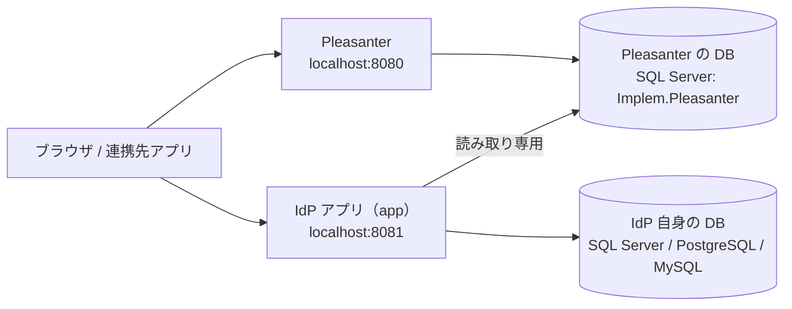

# 開発環境

**ホストに .NET SDK も node も DB クライアントも入れずに動かせる**ことを目指している。
Pleasanter・3 種類の RDBMS・IdP アプリを Docker でまとめて起動する。

## 構成



- **IdP は 2 つの DB を使う。** 取り違えないこと。

| DB | 用途 | 環境変数 |
| --- | --- | --- |
| Pleasanter の DB | ユーザー（`Users`）などを **読み取り専用で参照する**。IdP は書き込まない | `IDP_PLEASANTER_DB_PROVIDER` / `IDP_PLEASANTER_DB_CONNECTIONSTRING` |
| IdP 自身の DB | 署名鍵・クライアント登録・セッションなど、IdP が持つ状態 | `IDP_DB_PROVIDER` / `IDP_DB_CONNECTIONSTRING` |

- **同じ RDBMS サーバ内の別データベースでよい。** 検証環境の SQL Server は
  `Implem.Pleasanter`（Pleasanter）と `IdentityProvider`（IdP）を 1 台に同居させている
- **資格情報はサーバ側だけで保持する。** ブラウザへ渡さない（[`規約 8`](../.github/copilot-instructions.md)）

## 起動の順番

```bash
# 1. 検証環境（Pleasanter ＋ SQL Server ＋ IdP）
docker compose --profile sqlserver up -d --wait

# 2. 動いているか見る
./scripts/smoke.sh
```

| 何が | URL |
| --- | --- |
| Pleasanter | <http://localhost:8080> |
| IdP | <http://localhost:8081> |

- **Pleasanter（`db` / `codedefiner` / `pleasanter`）は profile を持たず、常に起動する。**
  初回は CodeDefiner がスキーマを作るので数分かかる
- **profile は IdP 自身の DB を選ぶ**（`sqlserver` / `postgres` / `mysql`）
- IdP のコンテナ内の待ち受けは 8080、ホストへは 8081 で出す。
  外から見える URL は `IDP_ISSUER`（既定 `http://localhost:8081`）で、
  SAML の EntityID と OIDC の `iss` になる。**公開する URL と必ず一致させること**
- 後片付けは `docker compose --profile "*" down -v`。
  ⚠️ **`down -v` は中身を全部消す。** Pleasanter のサイトも IdP の登録も消える

### RDBMS を切り替える

PostgreSQL / MySQL で動かすときは **IdP 自身の DB だけ**が替わる
（Pleasanter の DB は常に SQL Server）。接続先は環境変数で渡す。

```bash
# PostgreSQL
DEV_DB_PROVIDER=PostgreSql \
DEV_DB_CONNECTIONSTRING='Host=db-postgres;Database=idp;Username=postgres;Password=IdentityProvider#Test1' \
  docker compose --profile postgres up -d --wait

# MySQL
DEV_DB_PROVIDER=MySql \
DEV_DB_CONNECTIONSTRING='Server=db-mysql;Database=idp;Uid=root;Pwd=IdentityProvider#Test1' \
  docker compose --profile mysql up -d --wait
```

VS Code のタスク（後述）はこの環境変数を設定済み。

### SQL Server だけ、IdP の DB を作る係が要る

**SQL Server のイメージには「起動時にこのデータベースを作る」仕掛けが無い。**
接続文字列に書いても作られず、スキーマの適用（マイグレーション）もデータベース自体は作らない。
そこで `db-init` が `IdentityProvider` データベースを 1 つ作る（何度実行しても同じ結果）。

- PostgreSQL と MySQL には要らない（公式イメージの `POSTGRES_DB` / `MYSQL_DATABASE` が起動時に作る）
- `db-init` には profile を付けていない（`db` が常に起動する作りなので、常に走らせて構わない）
- CI も同じことをしている（[`integration.yml`](../.github/workflows/integration.yml)）

### Pleasanter の接続

| 項目 | 値 |
| --- | --- |
| イメージ | `implem/pleasanter:1.5.9.0`（検証環境の固定版。参照ソースの同期では変更しない） |
| DB | SQL Server 2025（`db`）。`Implem.Pleasanter` データベース |
| 管理者 | 公式イメージの既定（初回ログイン後にパスワードを変更させられる） |
| ポート | 8080 |

- **Pleasanter の `Rds.json` は `compose.yaml` の `configs` で差し替えている。**
  `Dbms` は環境変数で設定できず、公式イメージは PostgreSQL が焼き込まれているため
- ⚠️ **検証環境の接続は `Implem.Pleasanter_User`（読み書きできる）を使っている。**
  IdP の「読み取り専用」はアプリの設計で守るもので、DB の権限では強制していない。
  本番では **読み取り専用の資格情報**（`db_datareader` 相当）を別に作って渡すこと

## 画面を組み立てる

### ⚠️ `git pull` だけでは画面は新しくならない

**`wwwroot` は git で追跡していない。** 画面（`...Frontend`）は手元で組み立てた成果物を
`...Web/wwwroot` へ配っている。⚠️ **`dotnet run` や `dotnet build` は画面を組み立てない。**
これを知らずに繰り返すと、**古い画面を見続けることになる**。

```bash
# 画面だけ組み立て直す。依存が無ければ npm ci も走る
bash scripts/frontend-build.sh
```

VS Code のタスクなら **「画面をビルドする」**、F5 なら **「ビルド（アプリと画面）」** が
前処理として走るので、デバッグ起動している限りは意識しなくてよい。

## VS Code から

### タスク（`Ctrl+Shift+P` → `Tasks: Run Task`）

| タスク | 用途 |
| --- | --- |
| ビルド（アプリと画面） | 画面を組み立ててから .NET をビルド。既定のビルドタスク |
| テスト（単体） | 結合テストを除く |
| テスト（結合・3 RDBMS） | **先に検証環境を起動しておくこと** |
| フロントエンド: 型検査 / ビルド / 開発サーバ | `src/...Frontend` の `npm` スクリプト |
| 検証環境を起動（SQL Server / PostgreSQL / MySQL） | 上の「RDBMS を切り替える」と同じ |
| 検証環境をアプリだけ作り直す | コードを変えた後に使う。DB は残る |
| 検証環境を止める / ログ | |
| smoke | 動いているアプリへ HTTP で当てる |
| ライセンス検査 | Pleasanter 本体（AGPL）への参照が混ざっていないか |
| 秘密の鍵を作る | `IDP_SECRET_KEY` に入れる値を作る |

### デバッグ（`F5`）

**先に「検証環境を起動」を実行しておくこと。** DB と Pleasanter は Docker 側のものへ繋ぐ。
F5 で起動したアプリは <http://localhost:5067> で待ち受ける（コンテナの 8081 と衝突しない）。

- **アプリ（SQL Server / PostgreSQL / MySQL の検証環境へ繋ぐ）** — IdP 自身の DB を選ぶ
- **結合テストをデバッグ** — `IDP_INTEGRATION=1` を渡して起動する
- **画面（ブラウザ）** — Chrome を開く

## 環境変数

**一覧と既定値は [`設定パラメータ一覧.md`](設定パラメータ一覧.md)。** 起動に最低限要るのは次の 6 つ。

| 変数 | 内容 |
| --- | --- |
| `IDP_PLEASANTER_DB_PROVIDER` / `IDP_PLEASANTER_DB_CONNECTIONSTRING` | Pleasanter の DB。**読み取り専用で参照する。資格情報を含むのでブラウザへ渡さない** |
| `IDP_DB_PROVIDER` / `IDP_DB_CONNECTIONSTRING` | IdP 自身の DB |
| `IDP_SECRET_KEY` | 署名鍵などを守る鍵。**失うと保存済みの署名鍵が復号できなくなる。** 控えを取ること。作り方は `--generate-secret-key` |
| `IDP_ISSUER` | IdP の外から見える URL（SAML の EntityID・OIDC の `iss`）。既定 `http://localhost:8081` |

- 検証環境では `IDP_DB_ALLOW_INSECURE` / `IDP_PLEASANTER_DB_ALLOW_INSECURE`（自己署名の証明書の DB へ繋ぐため）を渡している。
  **本番では設定しない**
- `compose.yaml` の `DEV_*` は **compose 側で値を差し替えるための変数**で、アプリの設定ではない
  （`DEV_DB_PROVIDER` → `IDP_DB_PROVIDER` のように渡している）

## 結合テストの注意

- **SQLite の分は常に動く**（IdP を別プロセスで起こして HTTP で当てる試験も、SQLite のファイルで動く）。
  **SQL Server / PostgreSQL / MySQL の実機に当てる分は、`IDP_INTEGRATION=1` を設定しないと何も検証せずに緑になる。**
  その緑を「通った」と読まないこと（CI は設定している）
- 結合テストは **DB を共有する**ので、並列に回さない（テストクラスの並列実行は止めてある）
- 接続先は tests 側が持つ（localhost の 11433 / 15432 / 13306。パスワードは検証用の固定値）。
  compose のポートを変えると通らなくなる

### 初回起動時の署名鍵を待つ

**結合テストの fixture は、`/ready`・OIDC の JWKS・SAML の署名証明書が揃うまで待つ。**
`/ready` は IdP 自身の DB の準備を確認するもので、署名鍵の生成完了までは保証しない。
鍵は OIDC → SAML の順に生成するため、JWKS だけを待つと SAML 鍵が無い途中状態で試験が始まる。
固定の待ち時間を足したり、署名鍵の存在・秘密鍵非公開の検証を外したりせず、両用途の公開を確認する。

根拠（2026-10-26 確認）:
`src/VehicleVision.PleasanterTools.IdentityProvider.Web/Program.cs` の起動処理と `/ready`、
同 `Services/SigningKeyService.cs` の `EnsureAsync`、
`tests/VehicleVision.PleasanterTools.IdentityProvider.Integration.Tests/IdpProcess.cs` の `IsReadyAsync`。
回帰テスト `IdpProcessReadinessTests` は、DB と OIDC だけが準備済みの状態を HTTP 応答で固定し、
SAML 未準備では待機を終えないことをルート・サブパス両方で確かめる。

```bash
# 外部 DB は不要。起動待ちの回帰テストと、実プロセスでの鍵一覧・秘密鍵非公開を確認する
filter='FullyQualifiedName~IdpProcessReadinessTests'
filter+='|FullyQualifiedName~AdminEndToEndTests.署名鍵の一覧と証明書が取れ秘密鍵は出ない'
dotnet test tests/VehicleVision.PleasanterTools.IdentityProvider.Integration.Tests -c Release \
  --filter "$filter"
```

**外部 DB の全件試験には使い捨ての専用 DB を使うこと。**
`TestDatabases.FreshAsync` は既存の IdP の表を削除し、
`PleasanterSchema.CreateAsync` もテスト用の Pleasanter 相当の表を作り直す。
稼働中のアプリや他の作業と接続先を共有したまま `IDP_INTEGRATION=1` で実行しない。
CI の専用サービスコンテナと実行条件は
[結合テストのワークフロー](../.github/workflows/integration.yml) を参照する。

## `_reference` について

`_reference/Implem.Pleasanter` は必要時に取得する Pleasanter 本体（AGPL v3）の非追跡ソース。
**事実確認のための参照専用で、コードの取り込みは禁止。**
読む前に次を実行する（開発ビルド・CI では取得不要）。

```bash
bash scripts/sync-reference.sh
```

共有先は `PLEASANTER_REFERENCE_DIR` で指定し、その場所を直接読む（リンクは作らない）。
確認した完全な SHA・ソースへの固定リンク・参照日を残し、実機未検証は明記する。
詳細は [`_reference/README.md`](../_reference/README.md)。
**イメージ（`Dockerfile`）へは入れない**（`.dockerignore` で除外している）。

取得処理は `bash scripts/test-sync-reference.sh` でネットワークなしに検証できる。
隔離は `bash scripts/reference-isolation-check.sh` と既存の `bash scripts/license-check.sh` で確認する。
IdP 固有のコメント・DB 名と実際の取り込みの区別は
`bash scripts/tests/test_reference_isolation.sh` で検証する。
これらは CI の既存 `license-check` ジョブでも実行し、CI に本体取得は追加しない。
配布形式は既存の portable ZIP と Docker イメージのまま維持する。
ZIP は発行後に `_reference`・`.git`・`.gitmodules` の混入も検査する。

## 作り直す前に

⚠️ **`docker compose down -v` は中身を全部消す。** Pleasanter のサイトも、IdP の登録も、
署名鍵も消える。消す前に次を控えること。

- **IdP の DB**（署名鍵・クライアント登録）と `IDP_SECRET_KEY`
- **Pleasanter の DB**（サイト定義とユーザーが入っている）
